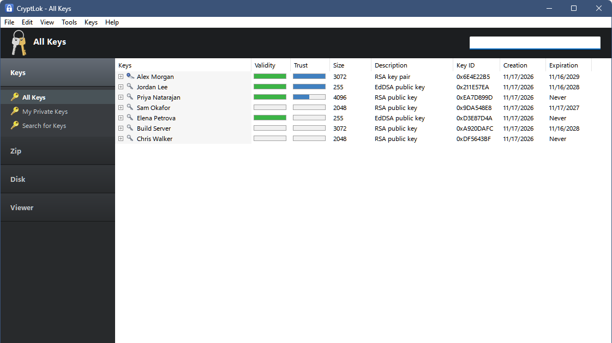
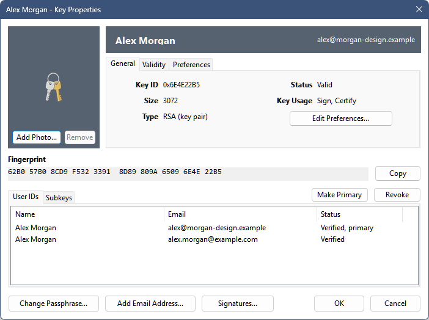
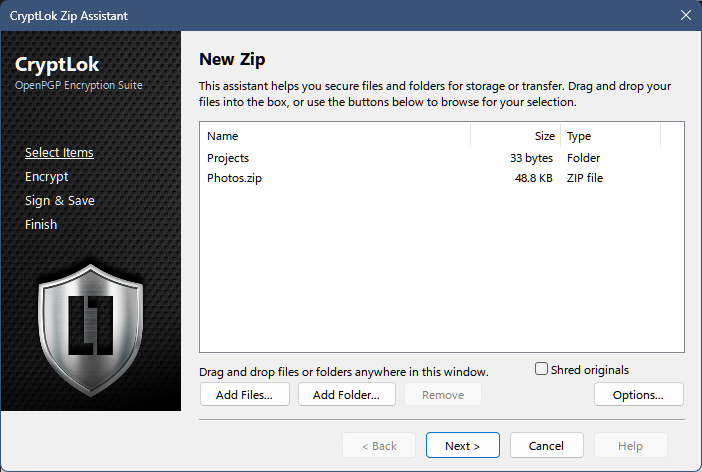
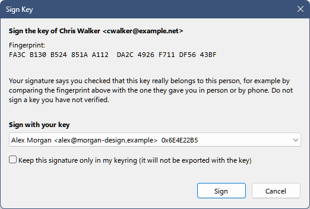

# CryptLok — OpenPGP Encryption Suite

CryptLok is my attempt to bring back the look and feel of the legacy PGP Desktop suite that many of us used for
years: the key manager, the tray clipboard tools, PGP Zip archives, self-decrypting archives, encrypted virtual disks
and the shredder, all in one Windows program. Under the hood it runs on the free, open GnuPG engine (included), so
everything it makes is standard OpenPGP that other tools can read.

CryptLok is an independent project. It is not affiliated with, endorsed by or connected to Broadcom, Symantec or
the PGP product line; "PGP" is a trademark of its owner and is used here only to describe the style of program.
All artwork is original or licensed; no vendor logos or artwork are used. Written in Delphi 12 (VCL).
(Also reachable as "CryptLoc".)

**Download:** the Windows installer is on the [Releases](https://github.com/bhoffman49/cryptlok/releases) page.

| Key Properties | Zip assistant | Signing a key |
|---|---|---|
|  |  |  |

*Screenshots use a throwaway demo keyring; the people and addresses are made up.*

## What it does
- **Keys** — key list (Keys, Validity, Trust, Size, Description, Key ID, Creation, Expiration), Key Properties window,
  new key pairs, copy/export public keys, delete, trust levels.
- **Import** — reads classic `pubring.pkr` / `secring.skr` (and `.asc`/`.gpg`) from copies, previews first, asks the
  passphrase in a classic dialog (gpg loopback pinentry, wiped from memory afterwards) and reports per key.
- **Clipboard** — tray menu: Encrypt, Sign, Encrypt & Sign, Decrypt & Verify, Edit, Clear; UTF-8; optional
  auto-clear of decrypted text after N seconds.
- **Disk** — encrypted virtual disks on the installed VeraCrypt: a random keyfile wrapped with your GnuPG key
  (`<disk>.hc.key.gpg`), single owner/multi-key, mount/unmount from My Disks or the tray. VeraCrypt is not bundled.

- **Zip** — encrypt files and folders into a `.pgp` archive with a wizard (Select Items, Encrypt, Keys or
  Passphrase, Sign & Save, Finish). The format is the classic PGP Zip layout: a standard OpenPGP message with a
  "PGP" marker packet; one file is stored as itself, a folder or several items as a GNU tar. gpg and other OpenPGP
  tools can open these files. "Open a Zip" shows the contents and the signature check, then extracts.
  **Self-decrypting archives**: a passphrase-protected `.exe` that opens on any Windows PC with nothing installed
  (stub `sda\CryptLokSda.dpr`, embedded in CryptLok; payload is a standard OpenPGP message, decrypted by
  `OPD.PgpSym.pas` without GnuPG). The program icon can be changed per archive.
  **Explorer integration** (Tools > Explorer Integration, opt-in, per user, shows every registry entry first):
  right-click "Encrypt with CryptLok..." on files and folders, "Decrypt/Verify with CryptLok" on .pgp/.gpg/.asc,
  an archive file type with the zip icon, optional default for .pgp. Several selected files open one wizard.
- **Shredder** (Tools > Shred Files, right-click "Shred with CryptLok...", and "Shred originals" in the Zip wizard):
  overwrites with random data then zeros (1-49 passes, default 3), truncates, renames, deletes; read-only files are
  handled, system files and open files are reported, links are removed without touching their targets. Overwriting
  cannot guarantee erasure on SSDs/flash or NTFS journals (the window says so); wiping free space with `cipher /w`
  is suggested. No drivers, ever.
  **Wipe Free Space** (Tools): runs Windows' `cipher /w` on a chosen drive with a status window and a Stop button that
  removes cipher's temporary folder. CryptLok also stops GnuPG's background agent when you really exit.
- **Viewer**: reads an encrypted or signed text file (.asc/.pgp/.gpg) or the clipboard message in a window, with the
  signature check, without saving the decrypted text to disk. Binary or archive files open in the Zip window instead.
- **Signature files**: Tools > Sign a File makes a detached signature (`name.ext.sig`, or a text `.asc`) next to any file;
  double-click a `.sig`/`.asc` signature, or use Tools > Verify a Signature File, to check it against the file and see who
  signed it and when. Explorer Integration adds "Sign with CryptLok..." and a `.sig` file type with its own icon.
- **Key signing**: Sign Key certifies someone's key with one of yours; Key Properties > Signatures lists who has signed a key.
- **Message headers** (Tools > Options > Messages): the PGP blocks CryptLok makes for the clipboard and for exported keys carry
  `Version: CryptLok x.y.z` and an optional one-line `Comment:` of your choosing. Both can be switched off; they are not part of
  what is signed or encrypted.
- **Photo IDs and key preferences** (Key Properties): shows a key's photo, adds one from any picture (scaled to 120 x 144
  and under 6 KB, as the classic PGP help recommends) or removes it, and shows the preferred Cipher, Hash,
  Compression, Encoding and Keyserver read from the key. For your own keys, Edit Preferences... lets you tick and reorder the ciphers, hashes and compression methods and set a preferred keyserver (asks for the key's passphrase).
- **Master Keys** (Tools > Options): a list of keys added to everything you encrypt (clipboard, Zip, Disk), as in the
  classic PGP Options > Master Keys. Missing, expired or revoked master keys are skipped and shown as such.
- **Default key** (Tools > Options > Keys): which of your private keys is "you" (shown as "(you)" in the Zip wizard and always
  added to your own archives); automatic = the first private key on the keyring.
  Not done yet: passphrase-only + signing, Sign Only.

## Installing
Run `CryptLok-Setup-0.1.0.exe`. Windows 10/11, 64-bit. GnuPG 2.5 is included (in `GnuPG\bin` next to the program),
so nothing else is needed except VeraCrypt for the Disk pages. What's new: `CHANGELOG.md`.

**Windows SmartScreen.** The installer is not code-signed yet, so Windows may show "Windows protected your PC" the first
times it is downloaded. Click **More info**, check the publisher/file name, then **Run anyway**. Before that, check
that the download is the real one: compare its SHA-256 with `SHA256SUMS.txt` published next to it. In PowerShell:

    Get-FileHash .\CryptLok-Setup-0.1.0.exe

The hash printed must match the one in `SHA256SUMS.txt` (case does not matter). If it does not, delete the file.

**Explorer option.** "Add CryptLok to Explorer" (ticked by default) adds the right-click entries and the `.sig` file
type for the user who runs setup. Turn it on or off later in Tools > Explorer Integration. If you once picked CryptLok
for `.sig` files under "Open with" > "Always", Windows keeps that choice and the old icon; choose "CryptLok signature"
there once to get the signature icon.

**Uninstalling** removes the program and the Explorer entries but never your keys: `%USERPROFILE%\.cryptlok` stays.

## Requirements
- GnuPG 2.5: the bundled copy next to CryptLok.exe; otherwise `F:\GnuPG\bin\gpg.exe` or gpg on PATH (development).
- VeraCrypt 1.26+ in `C:\Program Files\VeraCrypt` or a folder chosen in Options > Disk (only for the Disk feature).

## Data location
`%USERPROFILE%\.cryptlok\` — `gnupg\` (isolated keyring, never your normal GnuPG home) and `settings.ini`.
Deliberately **not** under AppData: programs started from a packaged (MSIX) app such as the Claude desktop app get
AppData redirected to a private folder.

## Build
`build.cmd` (cgrc + dcc64) → `out\CryptLok.exe`. Icons: `python tools\mkassets.py`.
Installer: copy the GnuPG 2.5 runtime (the `bin` folder of a GnuPG/Gpg4win install) to `pgp-samples\bin`, then run
`installer\build-installer.cmd` (Inno Setup 6).

## Command-line switches (testing aids)
`/home:<dir>`, `/import:<file;file>`, `/clip:<encrypt|sign|encryptsign|decrypt|clear>`,
`/page:<newdisk|mydisks|adduser|recipients>`, `/dlg:<props|newkey|zip|about|shell|shred|wipe|viewer>`, `/tray` (start hidden),
`/zip:<path;path>` (open the Zip wizard with items), `/zipopen:<file.pgp>`, `/zipstep:<0-5>` and
`/zipauto:<out.pgp>` (wizard test aids), `/signfile:<file>` (Sign a File window), `/proptab:N` `/listtab:N` (Key Properties tabs), `/multi` (skip the single-instance
hand-over). Used by the installer: `/installshell` (add the Explorer entries, no .pgp default) and `/removeshell`.

## Release
`build.cmd`, then `installer\build-installer.cmd` → `out\CryptLok-Setup-<version>.exe` and `out\SHA256SUMS.txt`.
Publish both files together.

## Decisions
- **No email-client integration** (the old Messaging/proxy feature). It was fragile in the original product and modern
  mail (OAuth, cloud accounts, Outlook add-ins) makes it worse. Use the Clipboard menu with any mail program instead.
  The Messaging sidebar section stays a placeholder.
- Disks are single-owner (several keys may open one disk) on the installed VeraCrypt; no `.pgd` support.
